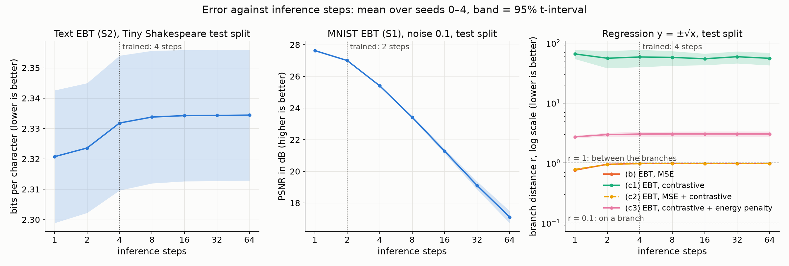
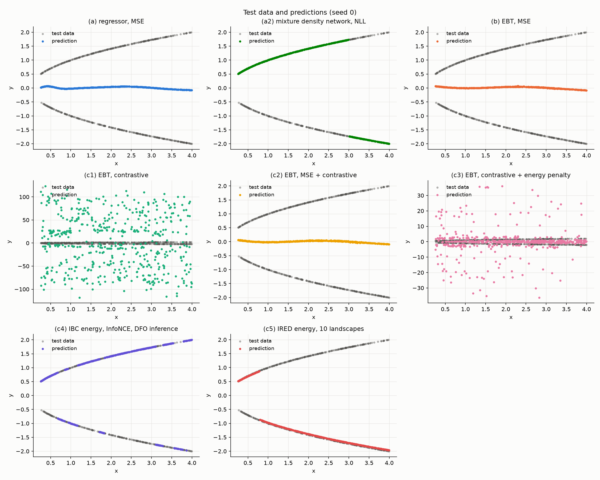

# Equipoise

- **Tested:** an independent reimplementation of the Energy-Based Transformer against same-size
  baselines, at equal parameters and equal training steps, on three small tasks.
- **Found:** at this scale more thinking did not improve the result, and the energy did not
  select better candidates on text or MNIST; the EBT was not better than its baseline at the
  pre-registered settings.
- **Next:** from v1.1, the comparison of families at equal training compute on text8.

Families of text generation compared at equal training compute, under one protocol, at small
scale. This is v1.0: an independent reimplementation of the Energy-Based Transformer, compared
with same-size baselines on three small tasks. The comparison of families is built in the next
versions (see [Roadmap](#roadmap)).

[![CI][ci-badge]][ci]
[![Licence: MIT][licence-badge]](LICENSE)
[![Python 3.12][python-badge]][python]
[![DOI][doi-badge]][doi]

[ci-badge]: https://github.com/DeOcxan/equipoise-lm/actions/workflows/ci.yml/badge.svg
[ci]: https://github.com/DeOcxan/equipoise-lm/actions/workflows/ci.yml
[licence-badge]: https://img.shields.io/badge/licence-MIT-blue.svg
[python-badge]: https://img.shields.io/badge/python-3.12-blue.svg
[python]: https://www.python.org/downloads/
[doi-badge]: https://zenodo.org/badge/1078664158.svg
[doi]: https://doi.org/10.5281/zenodo.24517958

## What this is

Papers on text generation report their families at different scales, on different data and under
different protocols, so their claims cannot be set side by side. The families include
autoregressive transformers and diffusion, flow, energy-based and recurrent-depth models.
Equipoise measures them under one protocol and at equal training compute, at a scale that anyone
can rerun on one machine. Hypotheses and decision rules are fixed before measuring. The project
asks how the families compare in quality, cost and return on inference-time compute, and whether
the central claim of each family's paper holds ([docs/design.md section
1.1](docs/design.md#11-main-question)).

v1.0 contributes the first family and the measurement machinery. It contains an independent
reimplementation of the Energy-Based Transformer (EBT) [EBT], whose gradients and thinking loop are
checked against finite differences. It asks seven questions about the EBT on three tasks with 5
seeds each. Five are answered by their rules (G1 to G5), G7 is answered in part, at equal
parameters and equal steps only, and G6 was not run. Every result file, checkpoint and table
needed to rerun them is published. Some v1.0 decisions were made after results had been seen, as
listed under [Limitations](#limitations).

The name: equipoise is the state of genuine uncertainty about which option is better, the
condition for a fair comparison.

## Findings of v1.0

Values are the mean over seeds 0–4 ± half-width of the 95% t-interval. The labels (a) to (c5), S1,
S2, I and the others are defined in the [glossary](docs/glossary.md).

- The reimplementation's gradients and thinking loop pass their checks against finite
  differences and hand-derived values
  ([G1](docs/questions.md#g1-is-the-implementation-faithful-to-the-method)).
- At equal parameters and equal training steps the EBT is worse than its baseline on text, and on
  MNIST at the trained step count, while it spends more compute per training step. On MNIST at 1
  inference step it is slightly better, which is not the pre-registered comparison. On regression
  both predict near the mean of the two branches
  ([G7](docs/questions.md#g7-is-the-comparison-fair-at-equal-cost)).
- More thinking does not help. Text bits per character stay within the seed spread from 1 to 64
  inference steps, though they are slightly higher at 64 steps on every seed. MNIST PSNR falls
  already at the trained 2 steps and further beyond them
  ([G3](docs/questions.md#g3-how-does-error-scale-with-thinking)).

  

  *Error against 1 to 64 inference steps, mean over seeds 0–4 with the 95% interval as a band; the
  dotted line marks the trained step count. The text axis is zoomed: from 1 to 64 steps the bits
  per character rise by 0.014 (2.3208 to 2.3344). Regression r is on a log scale, with reference
  lines at r = 1 (between the branches) and r = 0.1 (on a branch); (c2) lies on (b).*
- The energy does not select better candidates on text or MNIST: choosing the lowest-energy
  candidate is worse than random selection
  ([G4](docs/questions.md#g4-does-energy-verify-answers)).
- The paper's out-of-distribution effect is not observed at this scale
  ([G5](docs/questions.md#g5-does-thinking-help-more-out-of-distribution)).
- With two correct answers per input, the EBT trained with the paper's objective, (b), predicts
  near the mean of the two, as does (c2). The model (c1) diverged, and (c3) does not reach a
  branch, for a cause that was not established. Only the models with objectives from outside the
  paper, (a2), (c4) and (c5), reach a branch, and they return one branch per input
  ([G2](docs/questions.md#g2-why-use-an-energy)).

  

  *Test data and predictions against x, seed 0: (a), (b) and (c2) predict near the mean, (c1)
  diverged, (c3) is scattered, and (a2), (c4) and (c5) lie on the branches.*

  | Label | Model |
  |---|---|
  | (a) | feed-forward regressor trained with mean squared error |
  | (a2) | mixture density network, trained by negative log-likelihood |
  | (b) | EBT with the paper's objective: S2 thinking, mean squared error of the final candidate |
  | (c1) | EBT trained with the contrastive energy loss alone |
  | (c2) | EBT trained with mean squared error plus the contrastive loss |
  | (c3) | EBT trained with the contrastive loss plus an energy-magnitude penalty |
  | (c4) | implicit behavioural cloning energy: InfoNCE training, derivative-free inference |
  | (c5) | IRED energy: a sequence of noised energy landscapes, annealed gradient inference |

  S1 detaches the candidate between thinking steps and averages the losses of all steps. S2 does
  not detach it, keeps the second-order graph of the final step only and uses the final step's
  loss. The other labels and quantities are in the [glossary](docs/glossary.md).

## Results

At equal parameters and equal training steps, test split, 5 seeds:

| Task | Metric | EBT | Baseline |
|---|---|---|---|
| Text, Tiny Shakespeare | bits per character, lower is better | 2.332 ± 0.022 (S2, 4 inference steps) | 2.266 ± 0.020 (causal Transformer) |
| MNIST denoising, noise 0.1 | PSNR in dB, higher is better | 27.00 ± 0.03 (S1, 2 inference steps) | 27.54 ± 0.04 (one-pass denoiser) |
| Regression, y = ±√x | branch distance r, lower is better | 0.979 ± 0.001, EBT (b) with mean squared error | 0.973 ± 0.002, feed-forward regressor (a) |

Sources: `results/text/lm/full/table.md`, `results/mnist/denoising/full/table.md` and
`results/regression/g2/full/table.md`. Per training window the text EBT made about 4.49 forward
and 4.49 first-order backward passes plus 1.50 second-order passes, against 1 and 1 for the
Transformer.

On MNIST at 1 inference step the EBT reaches 27.63 ± 0.05 dB, above the denoiser at 27.54 ± 0.04.
The pre-registered comparison is at the trained 2 steps, so this is reported, not decided
(`results/mnist/g3_g4/full/table.md`). On regression both (a) and (b) predict near the mean of
the two branches (r ≈ 1). Neither solves the task, and the small difference in r is not a ranking.

Thinking, verification and out of distribution on text and MNIST
(`results/<task>/g3_g4/full/table.md` and `results/<task>/g5/full/table.md`):

| Question and quantity | Text EBT, bits per character | MNIST EBT, PSNR in dB |
|---|---|---|
| G3, 1 inference step | 2.3208 ± 0.0218 | 27.6317 ± 0.0536 |
| G3, trained step count | 2.3318 ± 0.0222 (4 steps) | 27.0003 ± 0.0307 (2 steps) |
| G3, 64 steps | 2.3344 ± 0.0215 | 17.1189 ± 0.3812 |
| G4, Spearman ρ of energy and error | 0.0482 ± 0.2094 | 0.6124 ± 0.0083 |
| G4, best-of-32 fraction of the oracle gain | −0.450 ± 0.242 | −0.379 ± 0.025 |
| G5, I in distribution | −0.0095 ± 0.0060 | −10.2741 ± 0.9499 |
| G5, I out of distribution | −0.0003 ± 0.0074 | −0.2149 ± 0.1340 (noise 0.2) |
| G5, outcome | 3 | 3 |

Regression EBTs and energies (`results/regression/g3_g4/full/table.md` and
`results/regression/g5/full/table.md`):

| Model | G3 ranges of r | G4 Spearman ρ | G4 best-of-32 fraction | G5 outcome |
|---|---|---|---|---|
| (b) | rising 1–4, flat 4–64 | −0.1694 ± 0.1290 | 0.003 ± 0.050 | 3 |
| (c1), diverged | falling 1–16, flat 16–64 | 0.8650 ± 0.0447 | 1.000 ± 0.000 | 4 |
| (c2) | rising 1–4, flat 4–64 | 0.0168 ± 0.2449 | −0.020 ± 0.044 | 3 |
| (c3) | rising 1–2, flat 2–64 | 0.1674 ± 0.3707 | −2.049 ± 2.490 | 3 |
| (c4) | no step count | −0.2358 ± 0.1165 | 0.020 ± 0.040 | not measured |
| (c5) | no step count | 0.0850 ± 0.4003 | −0.558, 1 of 5 seeds defined | not measured |

- G3. The range rule calls the text curve flat, as it compares the curve with the spread across
  seeds. G5 compares 1 and 64 steps within each seed. On all 5 seeds the bits per character at 64
  steps are higher than at 1 step, so the paired comparison detects a small degradation
  ([G3](docs/questions.md#g3-how-does-error-scale-with-thinking)).
- G4. For the regression models that did not diverge, ρ is about 0 or negative, and best-of-32 by
  lowest energy is not better than random. Only (c1), the diverged model, selects as well as the
  oracle. On text and MNIST selection by energy is worse than random
  ([G4](docs/questions.md#g4-does-energy-verify-answers)).
- G5. The outcomes are those of [docs/method.md section
  20.2](docs/method.md#202-relative-improvement-its-interval-and-the-outcome). For text the report
  words outcome 3 as "Thinking degrades the result in distribution and out of distribution on
  average; the relative degradation out of distribution is not measurably different. This is not
  the paper's effect." In plain terms, thinking degrades the text result in distribution on its
  interval. Out of distribution it has no measurable effect, with a mean slightly below 0
  ([G5](docs/questions.md#g5-does-thinking-help-more-out-of-distribution)).
- G6, the training-component ablations, was not run in v1.0. It moves to W5 in v1.1 (planned).
- G7 was measured only at equal parameters and equal steps (the first table). Its part at equal
  cost and its plots are planned for v1.1.

### Comparison with the paper's numbers

The paper's numbers are not directly comparable with these. Its language models use the
GPT-NeoX-20B tokenizer at context length 256 ([EBT] Table D.2), and its thinking experiments use
the xxs size, 384 wide and 6 layers deep ([EBT] Appendix D.1.2). The authors' image code works on
three RGB channels ([docs/method.md section 4.2](docs/method.md#42-images)). This project uses
characters of Tiny Shakespeare, one-channel MNIST and a regression task, at smaller sizes. The
implementation is checked against the authors' code, with every difference and corrections 13.1
to 13.4 in [docs/method.md section 13](docs/method.md#13-disagreements). Its gradients are
checked against finite differences
([G1](docs/questions.md#g1-is-the-implementation-faithful-to-the-method)). The paper's claims are
compared one by one in the [claims table](docs/questions.md#the-ebt-papers-claims-w2) of
docs/questions.md. The negative results hold at this scale and may not transfer to the paper's
scale ([Limitations](#limitations)).

## Limitations

v1.0 is small. It has one model size and one dataset per task, about 8.2 passes over Tiny
Shakespeare, and equal training steps rather than equal compute. Several best checkpoints are at
or near the last step, the searches used one seed, and the intervals cover training randomness
only. Everything ran on one machine, whose MPS runs are not bit-reproducible. The full list,
including the decisions and revisions made after results had been seen, is in [docs/questions.md,
Limitations and threats to validity](docs/questions.md#limitations-and-threats-to-validity).

## Quick start

Tested on Python 3.12. macOS on Apple silicon (MPS):

```sh
python3 -m venv .venv
source .venv/bin/activate
pip install -r requirements.txt
pip install --no-deps -e .
```

Linux, CPU only:

```sh
python3 -m venv .venv
source .venv/bin/activate
pip install --no-deps --index-url https://download.pytorch.org/whl/cpu torch==2.15.0
pip install -r requirements.txt
pip install --no-deps -e .
```

Data (not in the repository; sources, checksums and terms in
[docs/reproducing.md](docs/reproducing.md#data)):

```sh
mkdir -p data/mnist/raw data/text/raw
curl -L -o data/mnist/raw/train-images-idx3-ubyte.gz https://ossci-datasets.s3.amazonaws.com/mnist/train-images-idx3-ubyte.gz
curl -L -o data/mnist/raw/t10k-images-idx3-ubyte.gz https://ossci-datasets.s3.amazonaws.com/mnist/t10k-images-idx3-ubyte.gz
curl -L -o data/text/raw/tinyshakespeare.txt https://raw.githubusercontent.com/karpathy/char-rnn/master/data/tinyshakespeare/input.txt
curl -L -o data/text/raw/pg1342.txt https://gutenberg.pglaf.org/cache/epub/1342/pg1342.txt
```

`pg1342.txt` is Pride and Prejudice from Project Gutenberg. It is used only as out-of-distribution
text: for the out-of-distribution BPC of the text final runs and for G5.

The v1.0 checkpoints come from the GitHub release v1.0 and are checked and unpacked in the
repository root. The check against the result files is in
[docs/reproducing.md](docs/reproducing.md#the-v10-checkpoints). With the GitHub command-line tool:

```sh
gh release download v1.0 --repo DeOcxan/equipoise-lm
shasum -a 256 -c SHA256SUMS
for f in checkpoints-*-full.tar.gz; do tar -xzf "$f"; done
```

Or with curl, and `sha256sum` on Linux:

```sh
base=https://github.com/DeOcxan/equipoise-lm/releases/download/v1.0
for f in SHA256SUMS checkpoints-regression-g2-full.tar.gz checkpoints-mnist-denoising-full.tar.gz checkpoints-text-lm-full.tar.gz; do
  curl -LO "$base/$f"
done
sha256sum -c SHA256SUMS
for f in checkpoints-*-full.tar.gz; do tar -xzf "$f"; done
```

Regenerate the reports, tables and figures of the report tools from the committed per-seed files.
These tools need no checkpoints or data, while the experiments do ([docs/reproducing.md, Every
published file](docs/reproducing.md#every-published-file-and-how-it-is-made)):

```sh
python -m tools.regression_g2_report results/regression/g2/full
python -m tools.mnist_report results/mnist/denoising/full
python -m tools.text_report results/text/lm/full
python -m tools.g5_report
python -m tools.g3_figure
```

Rerun G3, G4 and G5 for text into a new directory, and report G5 from it. On Linux use
`--device cpu` instead of `--device mps`:

```sh
python -u -m ebt.experiments.inference_g3_g4 --task text --tier full --device mps --output ../equipoise-rerun/text/g3_g4/full
python -u -m ebt.experiments.inference_g5 --task text --tier full --device mps --output ../equipoise-rerun/text/g5/full
python -m tools.g5_report --results ../equipoise-rerun --tasks text
```

The commands for every task and stage are in [docs/reproducing.md](docs/reproducing.md). It also
explains what is overwritten, `--reuse-stale`, the fingerprints, the durations and the tests.

## Repository map

- `src/ebt/` holds the package: energies and the thinking loop (`core`), models, tasks and data,
  training, inference, and the experiments (`experiments`).
- `tools/` holds the report scripts that write the tables and plots, and the measurement tools.
- `tests/` holds the test suite. The tests marked `mps` run on Apple MPS only.
- `results/` holds one JSON file per run, with the tables and plots generated from them.
- `docs/` holds the design, the questions and answers, the method, and how to rerun everything.
- `CHANGELOG.md` lists the decisions and revisions of each version with their dates.

## Documentation map

- [docs/design.md](docs/design.md): the main question, the families, the protocol, the
  pre-registration lists, the metrics, the versions and the references.
- [docs/questions.md](docs/questions.md): the principles, the questions, the v1.0 answers and
  their limitations.
- [docs/method.md](docs/method.md): the implementation of the EBT and of the v1.0 experiments, with
  the points where the EBT paper and the authors' code disagree.
- [docs/numerics.md](docs/numerics.md): floating-point types, tolerances and reproducibility.
- [docs/reproducing.md](docs/reproducing.md): installation, data, checkpoints, rerun commands,
  outputs, figures, durations and tests.
- [docs/glossary.md](docs/glossary.md): model labels, training modes, questions and quantities.
- [CHANGELOG.md](CHANGELOG.md): the decisions and revisions of v1.0, with dates and reasons.

## Roadmap

All planned ([docs/design.md section 6](docs/design.md#6-versions)):

- v1.1: the autoregressive and EBT families at equal training compute on text8, questions C1 to C7.
- v1.2: MDLM, FLM with FMLM, and recurrent depth, with C8 and the DeepCrossAttention pilot (C9).
- v1.3: Duo and BD3-LM, and the comparison of distilled few-step models.
- v1.4: larger models, the compute-optimal frontier (C10), TinyStories at the character level.

## Citation

See [CITATION.cff](CITATION.cff). Release v1.0 is code version 0.1.0. The version stays unchanged
because `src/ebt/__init__.py` is hashed into every code fingerprint
([docs/reproducing.md](docs/reproducing.md#installation)). The DOI 10.5281/zenodo.24517958 cites
all versions; release v1.0 has its own DOI 10.5281/zenodo.24517959.

```bibtex
@software{mokrushin_equipoise_2026,
  author  = {Mokrushin, Artyom},
  title   = {Equipoise},
  version = {1.0},
  year    = {2026},
  url     = {https://github.com/DeOcxan/equipoise-lm},
  doi     = {10.5281/zenodo.24517958},
  license = {MIT}
}
```

## Licence

MIT, see [LICENSE](LICENSE).

## Reimplemented in v1.0

[EBT] A. Gladstone, G. Nanduru, M. M. Islam, P. Han, H. Ha, A. Chadha, Y. Du, H. Ji, J. Li,
T. Iqbal. Energy-Based Transformers are Scalable Learners and Thinkers. arXiv:2507.02092, v1,
2 July 2025; ICLR 2026 (oral). <https://arxiv.org/abs/2507.02092>,
<https://iclr.cc/virtual/2026/oral/10008833>

Authors' code: <https://github.com/alexiglad/EBT> (Apache-2.0). The EBT of this repository is a
reimplementation from the paper and that code, and no code from it is copied. The references of
every other family are in [docs/design.md](docs/design.md#references).
